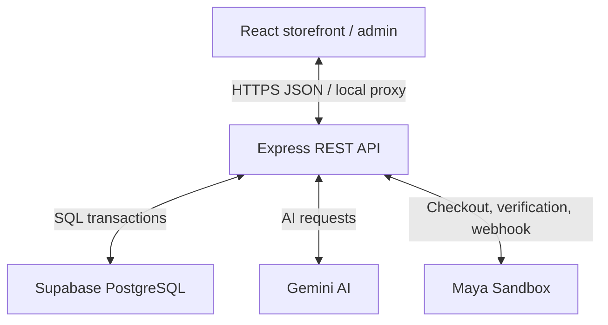
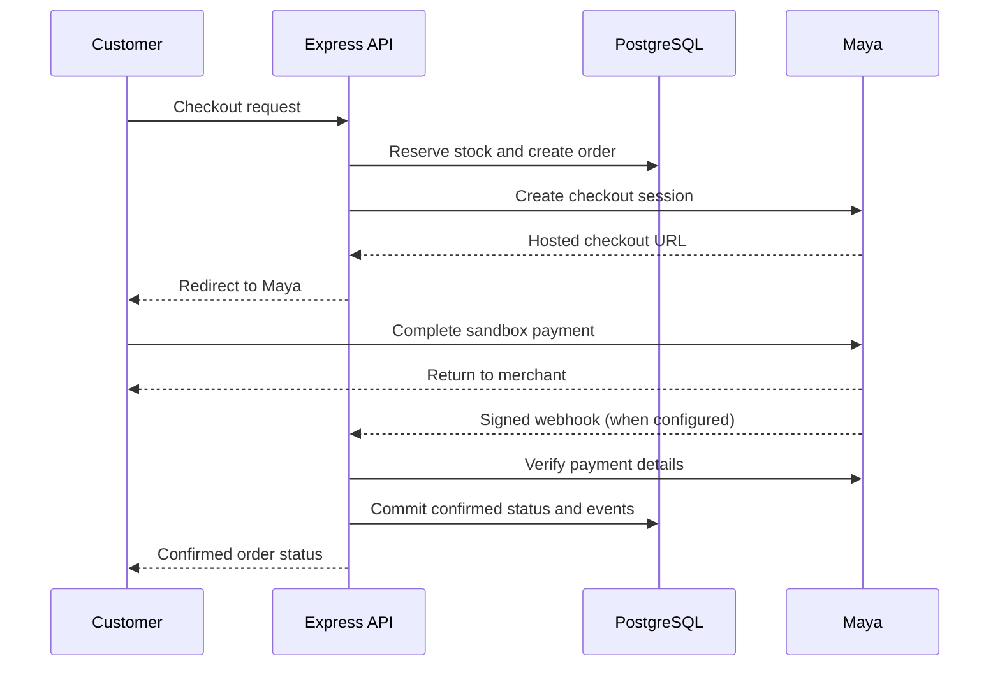

# Carry & Co. — System architecture and integration notes

**Updated:** November 27, 2026 — features through PR #9

Use this document to explain how the project actually works during the defense. [Demo checklist](demo-checklist.md) · [Test plan](test-plan.md) · [Setup and deployment](../README.md)

## 1. Architecture and technology

| Layer | Technology and responsibility |
| --- | --- |
| Frontend | React, Vite, React Router, reusable components, hooks, context, responsive CSS and PWA service worker. |
| API | Node.js / Express, versioned REST routes under `/api/v1`, JSON responses, authentication, validation and business services. |
| Database | Supabase PostgreSQL; stores customers/admins, categories, bags, carts, orders, reservations, payments, coupons, histories and notifications. |
| Payments | Maya Sandbox hosted checkout; Express creates sessions, verifies payment details and processes signed webhook events. |
| AI | Gemini on the backend; provides catalog-grounded recommendations, shopping guidance, image analysis and inventory explanations. |
| Deployment | Frontend on Vercel, backend on Render, database on Supabase. Locally, Vite proxies API requests to Express on port 4000. |
| Documentation | Swagger/OpenAPI and Postman, plus automated integration tests. |

The frontend does not connect directly to PostgreSQL or hold private provider keys. The backend owns permissions, inventory, totals, payment confirmation and recipient-scoped notifications.

### Trace an API request

Start with [API client](../frontend/src/api/client.js), [routes](../backend/src/routes/api.js), [controllers](../backend/src/controllers/api.js), [services](../backend/src/services/), [repositories](../backend/src/repositories/) and the [database schema](../backend/src/config/schema.sql).

## 2. Authentication, authorization and validation

- Registration normalizes email and stores a bcrypt password hash rather than plaintext. Login issues a JWT; authenticated requests send a bearer token.
- Express authentication and admin-role middleware protect restricted routes. Customers can retrieve their own account/orders/notifications, while admin routes require the admin role.
- Request schemas validate IDs, slugs, quantities, prices, initials, coupon data and image inputs. Invalid input returns an explanatory API error; a slug such as `test-bag` is lowercase and hyphen-separated.
- Keys belong in the backend `.env`; the public frontend configuration only identifies the API base URL. Never put a JWT secret, database password, Maya secret key or Gemini key in the frontend, GitHub, Postman export or presentation.

**Code:** [identity service](../backend/src/services/identity.js), [HTTP middleware](../backend/src/middleware/http.js), [validators](../backend/src/validators/input.js), [AuthContext](../frontend/src/context/AuthContext.jsx), [protected routes](../frontend/src/components/Protected.jsx).

## 3. Core store and business logic

| Feature | How the server handles it |
| --- | --- |
| Laptop fit and budget | Product queries filter against stored laptop capacity and price. This is an original bag-specific feature. |
| Monogram personalization | Valid uppercase initials are permitted only on eligible bags. The stored monogram fee is included in the cart quote. This is the second original bag-specific feature. |
| Pricing | Product prices, monogram fees, discount and ₱120 shipping are calculated on the server in integer centavos; the browser cannot dictate totals. |
| Coupons | Fixed and percentage discounts use a factory/strategy implementation; expiration, minimum spend and usage constraints are validated. |
| Stock | Available units are reserved transactionally at checkout; terminal failed, expired or cancelled payments release reservations when confirmed. Product removal is soft deletion, preserving order references. |
| Order status | Valid transitions advance verified paid orders from Paid to Processing to Shipped to Delivered. |

**Code:** [catalog service](../backend/src/services/catalog.js), [catalog repository](../backend/src/repositories/catalog.js), [pricing service](../backend/src/services/pricing.js), [discount patterns](../backend/src/patterns/discounts.js), [checkout service](../backend/src/services/orders.js).

### Design patterns to explain

- **MVC-style separation:** React presents the view; Express routes/controllers handle HTTP; services implement business rules; repositories and PostgreSQL represent the data layer.
- **Factory + Strategy:** `createDiscount(kind)` selects the percentage or fixed strategy. Each implements the discount operations through a common base class.
- **Composition:** `CheckoutService` receives its database, payment gateway and pricing dependencies. This lets integration tests substitute controlled provider responses.

## 4. Maya Sandbox checkout and verification

| Endpoint | Responsibility |
| --- | --- |
| `POST /api/v1/checkout/quote` | Calculate the authoritative cart total, shipping and discount. |
| `POST /api/v1/checkout` | Reserve stock, create order and open a Maya-hosted session. The same idempotency key reuses the existing order. |
| `POST /api/v1/orders/:id/verify` | Retrieve and verify the payment result from Maya. |
| `POST /api/v1/webhooks/maya` | Verify signature/timestamp and queue incoming payment events for processing. |
| `POST /api/v1/orders/:id/cancel` | Cancel an eligible pending checkout. |
| `POST /api/v1/orders/:id/restore-cart` | Restore eligible failed, expired or cancelled order items for a fresh attempt. |

A successful redirect is not proof of payment. The checkout service compares the actual gateway status, reference, amount and currency with the stored order. A verified success creates one paid transition; repeat events and checkout replay are handled without double counting. Invalid or mismatched confirmations do not mark the order paid. A terminal failure releases stock, and the customer can restore a retryable order to the cart.

A payment may fail on Maya's hosted page even though the local application successfully opened a session. Use only [official Sandbox test instruments](https://developers.maya.ph/reference/testing-and-validating-your-maya-checkout-integration). Locally, browser return verification can work without a webhook reaching localhost; webhook delivery must be verified separately on a publicly reachable configured endpoint.

**Code:** [Maya adapter](../backend/src/patterns/maya.js), [webhook registration](../backend/src/app.js), [checkout service](../backend/src/services/orders.js), [order page](../frontend/src/pages/Order.jsx).

## 5. Four Gemini-powered AI functions

All AI calls are made by Express using the common [Gemini client](../backend/src/services/gemini.js). The backend uses validated catalog/database data, validates provider output and controls failure handling. Provider-generated text is advice, not an authority on payment, prices, availability or reorder quantities.

| Feature | API endpoint | Input and output |
| --- | --- | --- |
| Bag Finder | `POST /api/v1/ai/discover` | Shopping prompt → matching in-stock catalog bags |
| Shopping Assistant | `POST /api/v1/ai/assistant` | Question and up to six recent messages → response and verified product links |
| Visual Bag Search | `POST /api/v1/ai/visual-search` | Resized bag image → visible-feature analysis and similar available bags |
| Inventory Advisor | `POST /api/v1/admin/ai/inventory` | Admin request → sales/stock metrics, suggested reorder quantities and advice |

### Bag Finder

Express selects in-stock products and recognizes budget and laptop constraints. Gemini ranks candidate IDs; the API validates the IDs and returns actual database product records. A timeout or unusable response can return up to four catalog matches with `aiAssisted: false`. A missing key returns `503 AI_UNAVAILABLE`. The frontend distinguishes **AI-Assisted picks** from **Catalog matches**.

**Code:** [discovery service](../backend/src/services/discovery.js), [Bag Finder](../frontend/src/pages/Discovery.jsx).

### Shopping Assistant

The service retrieves relevant public catalog data and store facts and sends the question plus recent conversation context to Gemini. Product references are verified against real catalog records before returning. When the provider is unavailable, the customer receives a help/fallback response and can browse the catalog. The answer does not grant access to admin data or modify the cart.

**Code:** [shopping service](../backend/src/services/shopping.js), [Shopping Assistant](../frontend/src/pages/ShoppingAssistant.jsx).

### Visual Bag Search

The browser accepts JPG, PNG or WebP up to 10 MB and prepares a resized JPEG. The backend validates the encoded photo (up to 1 MiB of decoded data), sends the image and catalog descriptions to Gemini, and rechecks matches against current in-stock products. Results describe visual similarity, not guaranteed identical brands or products. The app does not persist uploaded photos. A longer initial request and one bounded retry handle temporary provider failures; if still unavailable, the user can retry the selected photo or browse another AI tool.

**Code:** [photo preparation](../frontend/src/utils/prepareBagPhoto.js), [visual search service](../backend/src/services/visualSearch.js), [Visual Bag Search](../frontend/src/pages/VisualSearch.jsx).

### Inventory Advisor (administrator only)

The database sums quantities in orders with verified payments recorded in the past 30 days. Only public, active catalog bags are analyzed. The backend calculates:

| Criterion | Rule |
| --- | --- |
| Recent sales | Verified units sold over 30 days |
| Low stock | Available stock ≤ 4 |
| Target for products with sales | Maximum of 5 and round-up(30-day units sold × 14 ÷ 30) |
| Suggested reorder | Maximum of 0 and (target − available stock) |
| No recent sales | Target 0; low-stock items are recommended for manual review instead of automatic restock |

Example: 12 verified units sold and 2 available units gives a target of 6 and a suggested reorder of 4. Gemini prioritizes existing recommendations and explains them; it cannot choose different reorder quantities. A provider failure produces an **Inventory rules report** using the same deterministic calculations. The professional report includes metrics, recommendations, an explanation and policy details. It is read-only; the admin changes stock manually through Products.

**Code:** [inventory query](../backend/src/repositories/inventory.js), [inventory advisor service](../backend/src/services/inventoryAdvisor.js), [Inventory Advisor page](../frontend/src/pages/admin/InventoryAdvisor.jsx).

## 6. Admin dashboard, notifications and activity logs

### Dashboard

`GET /api/v1/admin/dashboard` returns all-time gross sales and paid order count (Paid, Processing, Shipped, Delivered), pending payment count, current low stock (active, non-deleted products with ≤4 available units), five latest orders and four recent activity events. The dashboard links to complete orders, inventory review and activity history. It is not an AI forecast. Internal payment flag/webhook-review fields remain available to backend logic but are not displayed as dashboard cards.

**Code:** [dashboard query in orders service](../backend/src/services/orders.js), [Dashboard page](../frontend/src/pages/admin/Dashboard.jsx).

### In-app notifications

| Recipient | Committed events |
| --- | --- |
| Customer | Own order placement, verified payment, processing, shipment, delivery, cancellation, expiry or payment failure. |
| Administrator | Store order/payment status events; a newly created eligible low-stock bag, crossing the low-stock threshold or reaching zero available stock. |

Notifications use the `notifications` table with recipient ID, event type, message, link, timestamp and read timestamp. Order/stock transitions write notifications within their existing transactions. Lists and read actions are scoped to the signed-in user even when the notification ID is supplied directly. The inbox provides filtering, pagination and mark-as-read controls. The shared React notification context refreshes the unread badge on navigation, visibility changes and approximately every 30 seconds in a visible online tab. This is an in-app notification system, **not** SMS, email or browser push.

| API endpoint | Purpose |
| --- | --- |
| `GET /api/v1/notifications` | Own inbox; supports unread filter and pagination |
| `GET /api/v1/notifications/unread-count` | Own unread count |
| `PATCH /api/v1/notifications/:id/read` | Mark one owned notification read |
| `PATCH /api/v1/notifications/read-all` | Mark own unread notifications read |

**Code:** [activity/notification repository](../backend/src/repositories/activity.js), [Notifications page](../frontend/src/pages/Notifications.jsx), [NotificationsContext](../frontend/src/context/NotificationsContext.jsx).

### Activity logs

`GET /api/v1/admin/activity` requires an administrator. It combines `admin_activity` records (product, category and coupon changes) with existing `order_history` and `stock_history`. Entries include event type, reference, description, actor and time. The API supports pagination and filtering by category. It preserves previously recorded order/stock history without duplicating it; new catalog/coupon activities and notifications are recorded from deployment onward. There is no customer access or log-editing UI.

**Code:** [activity repository](../backend/src/repositories/activity.js), [schema](../backend/src/config/schema.sql), [Activity Logs page](../frontend/src/pages/admin/ActivityLogs.jsx). Backend startup creates new tables idempotently without resetting existing records.

## 7. Mobile and offline behavior

React Router handles customer and admin pages. Context manages authentication, cart, network state and notifications; custom hooks handle API data loading. Vite PWA generates an installable manifest and Workbox service worker. Catalog GET requests use network-first caching; images use cache-first caching. The app can show previously cached public products offline, but checkout, private account/order data, admin actions and provider calls require the network. Private API responses are not included in the catalog cache.

**Code:** [app routes](../frontend/src/App.jsx), [PWA configuration](../frontend/vite.config.js), [feedback components](../frontend/src/components/Feedback.jsx), [cart context](../frontend/src/context/CartContext.jsx), [network context](../frontend/src/context/NetworkStatusContext.jsx).

## 8. What to say during the defense

“Carry & Co. is a mobile-first e-commerce PWA with a versioned Express REST API and PostgreSQL database. The server controls authentication, pricing, availability and payment verification. Gemini supports discovery, shopping guidance, visual search and admin inventory advice using catalog and sales data. The admin tools provide actionable summaries, private event notifications and an operational activity history.”

The recorded requirements come from the project's handoff; the instructor's original documents control exact grading. See the [test plan](test-plan.md) for what was tested locally versus what still needs live verification.
